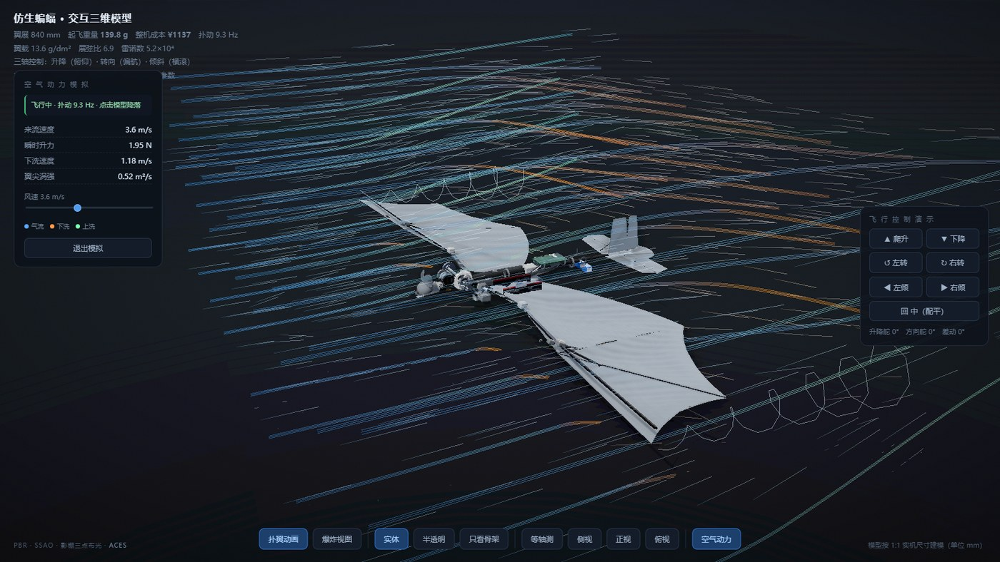

# Shadow Raider

> 一架按 1:1 实机尺寸建模的**仿生蝙蝠扑翼机**，连同把它打包成"双击即看"单文件的三维模型 Skill。



*空气动力模拟模式：翼尖涡、下洗气流与实时数据面板（升力 1.95 N / 下洗 1.18 m/s）*

### ▶ [在线直接打开模型](https://qihe007.github.io/Bionic-Shadow-Raider/)

不用下载、不用安装，浏览器里就能旋转模型、点开零件、切换视角、跑空气动力模拟。

**作者 / Author**：Qi He（第一创作人，原始设计与实现）

翼展 840 mm ｜ 起飞重量 139.8 g ｜ 整机成本 ¥1137 ｜ 扑动 9.3 Hz ｜ 翼载 13.6 g/dm²

---

## 1. 项目解释

Shadow Raider 是一个**工程化的三维模型交付物**，不是渲染出来的效果图。

模型按 1:1 实机尺寸（单位 mm）建立，17 个零件全部可点开查看规格、质量、成本与工艺要点；
肩关节的摆角由曲柄摇杆四杆机构按真实几何反解得出（连杆长度恒为 30.02 mm）；
气动数据按准稳态叶素理论核算，与结构强度、动力链转速互相自洽。

它解决的问题很具体：**做一个能发给别人、对方双击就能打开、不用装任何软件的三维模型**。
three.js、OrbitControls、后期处理库全部内联进一个 HTML，零外部请求，断网也能看。

模型本体页面标题为「仿生蝙蝠 · 交互三维模型」，`Shadow Raider` 是项目与 Skill 的名称。

---

## 2. 主要功能

### 查看与检视

| 功能 | 说明 |
|---|---|
| 自由视角 | 左键拖拽旋转、滚轮缩放、右键平移，无死角 |
| 零件点选 | 单击任意零件弹出参数卡：规格清单、质量、成本、工艺要点 |
| 零件目录 | 左侧列出全部 17 个零件，点击直达并高亮 |
| 材质渲染 | PBR 物理材质 + 影棚三点布光 + SSAO + ACES 色调映射 |

### 结构与视图

| 功能 | 说明 |
|---|---|
| 扑翼动画 | 连续扑动，四杆机构实时反解，摆角 ±30.6° |
| 爆炸视图 | 各部件沿装配方向散开看内部布置；连杆与球头自动淡出，避免出现"悬空件" |
| 三种渲染模式 | 实体 / 半透明 / 只看骨架 |
| 四个标准视角 | 等轴测、侧视、正视、俯视，一键切换 |

### 飞行与操纵（演示用）

| 功能 | 说明 |
|---|---|
| 六向控制 | 爬升 / 下降 / 左转 / 右转 / 左倾 / 右倾，另带回中配平 |
| 姿态联动 | 升降舵、方向舵、差动扭翼的角度实时显示在控制按钮下方 |
| 三轴合成 | 俯仰、偏航、横滚同时作用于机翼与尾翼 |

### 空气动力模拟

| 功能 | 说明 |
|---|---|
| 流场可视化 | 1600 个气流粒子 + 54 条积分流线 + 两条翼尖涡螺旋 |
| 实时面板 | 来流速度、瞬时升力、下洗速度、翼尖涡强 |
| 风速调节 | 2–6 m/s 滑块，默认 3.6 m/s |
| 颜色编码 | 蓝 = 正常气流，橙 = 下洗，绿 = 上洗 |
| 操纵响应 | 点爬升/下降改下洗强度，点左倾/右倾让两侧下洗不对称，点左转/右转产生侧洗 |

---

## 3. 安装方法

### 前置要求

| 项目 | 要求 |
|---|---|
| 浏览器 | Chrome / Edge / Firefox / Safari 等现代浏览器，需支持 WebGL |
| 运行时 | **无需** Node.js、Python 或任何依赖 |
| 网络 | **无需**联网（所有库已内联） |

### 方式 A：直接看模型（零安装）

1. 取得本项目目录（解压或复制）
2. 双击 `skills/shadow-raider/assets/shadow-raider.html`
3. 浏览器打开即可，无需启动服务器

也可以用命令行打开：

```bash
# Windows（cmd / PowerShell，在项目根目录执行）
start "" "skills\shadow-raider\assets\shadow-raider.html"
# macOS
open skills/shadow-raider/assets/shadow-raider.html
# Linux
xdg-open skills/shadow-raider/assets/shadow-raider.html
```

### 方式 B：安装为 Skill

把 `skills/shadow-raider/` **整个目录**复制到 skills 路径，目录名保持 `shadow-raider`：

| 作用域 | 目标路径 |
|---|---|
| 用户级（所有项目可用） | `~/.workbuddy/skills/shadow-raider/` |
| 项目级（仅当前项目） | `<项目根>/.workbuddy/skills/shadow-raider/` |

Windows 用户级路径示例：`C:\Users\<你的用户名>\.workbuddy\skills\shadow-raider\`

复制后目录结构应为：

```
shadow-raider/
├── SKILL.md            ← 必须在这一层
├── agents/
├── assets/
└── references/
```

安装后新开会话再试，触发词如"给我看那个三维仿生蝙蝠模型"。

### 验证安装是否成功

| 检查 | 期望结果 |
|---|---|
| 双击 HTML | 出现可旋转的蝙蝠模型，控制台无报错 |
| 左侧零件目录 | 显示 17 项 |
| 底栏按钮 | 10 个按钮均可点击，无报错 |
| 点「空气动力」 | 左侧弹出模拟面板，模型周围出现流场 |
| 点一下模型 | 状态变「飞行中 · 扑动 9.3 Hz」，流线明显弯曲绕流（不是平行直线） |
| `SKILL.md` 首行 | 有 `name: shadow-raider` 和 `description:` 字段 |

---

## 4. 使用方法

### 五分钟上手

1. **转到合适的角度**：左键拖拽。想快速到标准视角，点底栏「等轴测」。
2. **看零件**：单击机翼或电机，右侧弹出参数卡；点卡片右上角 × 关闭。
3. **拆开看结构**：点「爆炸视图」，各部件散开；再点一次复位。
4. **看内部**：点「半透明」，能看见齿轮组、舵机和电池的装配位置。
5. **进入气动模式**：点「空气动力」→ 相机自动切到斜前方视角 → **点一下模型**开始飞行 →
   流线从平行变成绕流，翼尖出现涡旋。
6. **操纵**：点右侧「飞行控制演示」里的「爬升」「左倾」等按钮，观察气流颜色和形态变化；点「回中」复位。
7. **退出**：点面板里的「退出模拟」。

### 鼠标与按钮对照

| 操作 | 结果 |
|---|---|
| 左键拖拽 / 滚轮 / 右键拖拽 | 旋转 / 缩放 / 平移 |
| 单击零件 | 打开该零件参数卡 |
| 底栏「扑翼动画」 | 开 / 关连续扑动 |
| 底栏「爆炸视图」 | 开 / 关零件散开 |
| 底栏「实体 / 半透明 / 只看骨架」 | 切换渲染模式 |
| 底栏「等轴测 / 侧视 / 正视 / 俯视」 | 切换标准视角 |
| 底栏「空气动力」 | 进入 / 退出流场模拟 |

### 作为 Skill 使用

直接用自然语言提需求即可，例如：

- "给我看这个三维仿生蝙蝠，我要能自己转"
- "把翼展改成 900 mm，重量和成本重新算"
- "这模型的升力够不够飞"
- "帮我截一张答辩 PPT 能用的模型图"

Skill 会读取 `references/model-spec.md` 取准确数据，复制资产交付，并按清单做无头浏览器验证。

---

## 5. 输入输出示例

### 5.1 Skill 调用示例

| 输入（你说） | 输出（拿到什么） | 产物 |
|---|---|---|
| 给我看这个三维仿生蝙蝠，我要能自己转 | 复制一份模型到指定目录，附验证结论：零控制台报错、17 个零件可点、10 个按钮正常 | `shadow-raider.html` |
| 把翼展改成 900 mm，重量和成本重新算 | 修改 `MASS` / `COST` 表与翼展常量，HUD 自动同步，给出新旧对比表 | 新版 `shadow-raider.html` |
| 这模型的升力够不够飞 | 引用 `model-spec.md`：以 8 Hz 为核算基准，升力余量 +18% ~ +97%（原方案同条件仅 53–89%，飞不起来）；翼根碳管安全系数 8.8 | 文字结论 + 数据出处 |
| 帮我截一张答辩用的模型图 | 无头浏览器打开、摆好视角、截图 | `PNG`（1600×900） |
| 气流的线为什么是直的 | 定位 `aeroField()`，检查飞行状态与下洗强度下限，修完重新打包并给出流场采样数值 | 修复后的 HTML + 数值证据 |

### 5.2 模型使用示例（手工操作）

| 输入（操作） | 输出（屏幕上发生什么） |
|---|---|
| 双击 HTML | 出现可旋转的蝙蝠模型，左上角 HUD 显示翼展 840 mm / 139.8 g / ¥1137 |
| 单击「主电机」 | 弹出参数卡：1404 KV3800 外转子 Ø14×19 mm、14.4 g、¥135 |
| 点「爆炸视图」 | 各部件沿装配方向散开，看清减速齿轮组与曲柄连杆的相对位置；连杆/球头同时淡出 |
| 点「空气动力」→ 点模型 | 面板状态变为"飞行中 · 扑动 9.3 Hz"，瞬时升力 1.95 N，流线开始绕流并在翼尖卷起 |
| 点「左倾」 | 模型横滚 18°，两侧下洗不再对称（右翼下洗增强、左翼减弱），面板数值随之变化 |
| 拖动风速滑块到 6.0 | 面板来流速度变 6.0 m/s，粒子与流线速度加快，下洗速度按比例增大 |

### 5.3 参数修改示例

| 想改什么 | 改哪里（HTML 内搜索） | 效果 |
|---|---|---|
| 零件重量 / 成本 | `var MASS = {` / `var COST = {` | HUD 的起飞重量与整机成本自动重算 |
| 扑动频率 | `Math.sin(aero.t * Math.PI * 2 * 9.3)` 中的 `9.3` | 扑翼快慢与面板文案同步变化 |
| 机翼安装角 | `w.group.rotation.x = qWing - 0.0873` 中的 `0.0873`（弧度） | 前缘抬升角改变，影响平均迎角 |
| 下洗强度 | `aeroField()` 中 `U * 0.40` 的系数 | 流线向下偏折的幅度 |
| 翼尖涡强弱 | `gAmp = 82000 * lfV` | 翼尖螺旋的紧密度与半径 |
| 流线密度 | `var LXS` / `var LYS` 数组 | 改列数/层数（同时调整 `buildAero()` 里的 `NL`） |

改动细节与已知陷阱见 `skills/shadow-raider/references/customization.md`。

---

## 项目结构

```
Shadow Raider/
├── README.md                        本文件
└── skills/
    └── shadow-raider/
        ├── SKILL.md                 Skill 定义：触发条件、交付流程、验证清单
        ├── agents/
        │   └── shadow-raider.md     交付/校验子代理的角色与工作流
        ├── assets/
        │   └── shadow-raider.html   三维模型本体（约 800 KB，零外部依赖）
        └── references/
            ├── model-spec.md        整机参数、17 件零件表、传动链、气动校核、飞控
            └── customization.md     改动锚点、打包顺序、7 个常见坑
```

---

## 工程数据摘要

| 项目 | 数值 |
|---|---|
| 翼展 / 翼面积 / 展弦比 | 840 mm / 1028 cm² / 6.9 |
| 起飞重量 / 翼载 | 139.8 g / 13.6 g/dm² |
| 动力链 | 1404 KV3800 → 36:1 减速 → 9.3 Hz |
| 翼根摆角 | ±30.6°（连杆 30.02 mm 恒定） |
| 翼根弯矩 / 碳管应力 | 0.145 N·m / 68 MPa（安全系数 8.8） |
| 飞控 | ESP32 三轴增稳 + 差动扭翼混控 |
| 雷诺数 | 5.2×10⁴ |

完整零件清单（含逐件质量、成本、规格、工艺要点）见 `skills/shadow-raider/references/model-spec.md`。

## 延伸阅读

- **[研究成果与技术报告](Shadow-Raider-Research-Findings-Text.md)** —— 12 章正文 + 2 个附录、
  10 张分析图。含文献综述、准稳态叶素积分推导、展向下洗与 Lamb-Oseen 翼尖涡建模、
  四杆机构两圆求交反解、翼根强度校核、惯性载荷分析、三轴混控与三次迭代验算

---

## 技术栈

- **渲染**：three.js r128（非模块版）、OrbitControls、MeshPhysicalMaterial + PMREM 影棚环境
- **后期**：SSAO + UnrealBloom + ACES 色调映射
- **贴图**：程序化 Canvas 生成（碳纤维 3K 斜纹、TPU 织物、SLS 颗粒、商品标签），无外部图片
- **气动**：解析流场（来流 + 机体排开 + 展向下洗 + 上下环流 + Lamb-Oseen 翼尖涡）+ RK1 流线积分

---

## 已知限制

- **气动不是 CFD**：流场是准稳态解析模型，用于展示"气流怎么绕过机翼"，不能替代数值仿真
- **不能导出模型文件**：本项目不提供 GLB / STEP / STL 导出，只交付可交互的 HTML
- **零件参数是设计值**：质量与成本为设计核算值，非实测；实际装配会有偏差
- **改参数要编辑 HTML**：仓库只提供打包后的单文件，改样式或数值需直接编辑内联代码（见 `customization.md`）
- **低帧率环境**：软件渲染（如无头浏览器）下帧率很低，气动面板靠时间节流刷新，属正常现象

---

## 许可证

Copyright © 2026 **Qi He**（第一创作人）。本项目采用 **MIT License**，全文见 [LICENSE](LICENSE)。

你可以自由地使用、复制、修改、合并、发布、分发、再许可和销售本项目的副本，
唯一要求是保留版权声明与许可声明。软件按"现状"提供，不含任何担保。

模型内联的第三方代码均为 MIT 许可，版权归各自原作者：

| 组件 | 来源 |
|---|---|
| three.js r128 | © three.js authors |
| OrbitControls / EffectComposer / RenderPass / ShaderPass / MaskPass | © three.js authors |
| SSAOPass / SSAOShader / SimplexNoise | © three.js authors |
| UnrealBloomPass / CopyShader / LuminosityHighPassShader | © three.js authors |

如需在衍生作品中替换为自己的许可证，请同时替换 `LICENSE` 与本段说明。

