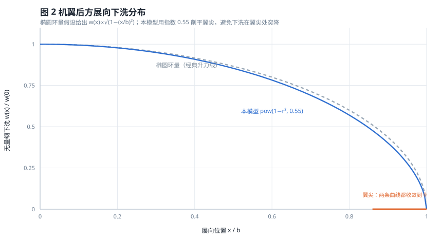
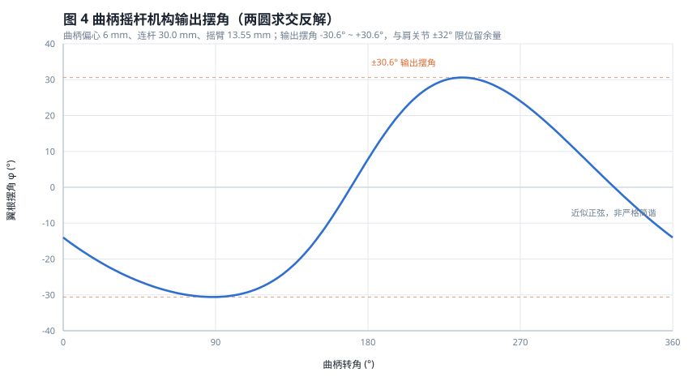
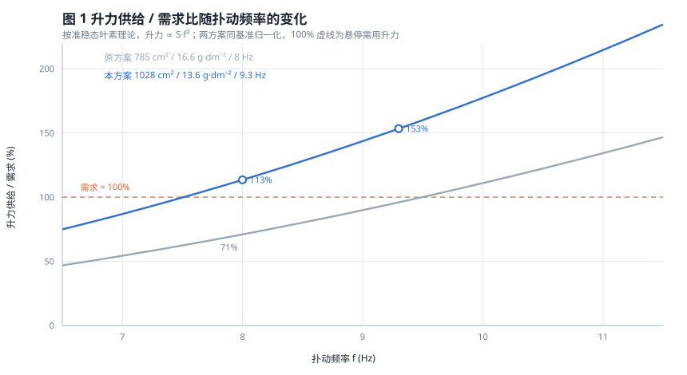
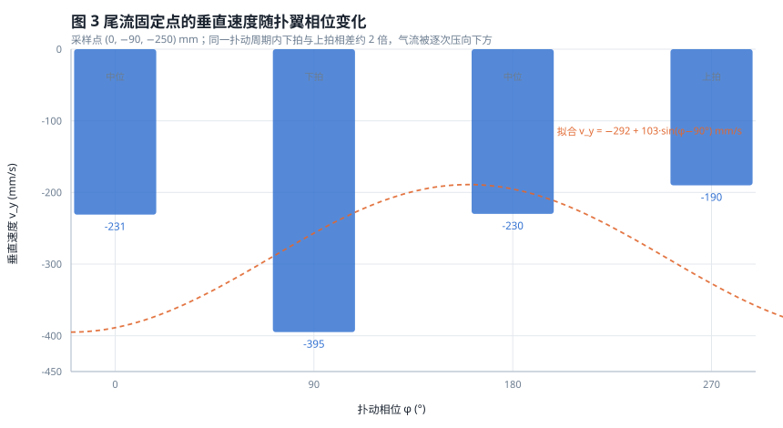

# Shadow Raider 研究成果与技术报告

**作者**：Qi He　｜　**版本**：v0.1.2　｜　**日期**：2026-11

> 本文记录 Shadow Raider 仿生蝙蝠扑翼飞行器从方案到数字样机的推导过程：气动模型怎么建、
> 结构怎么算、哪一版失败过、改了什么。文中每个公式都给出代入值与计算结果，
> 每个结论都标注文献出处或实测来源，便于复核。

---

## 摘要

本文针对翼展 840 mm、起飞重量 139.8 g 的仿生蝙蝠扑翼飞行器，建立了以准稳态叶素理论为主干、
含展向椭圆下洗与 Lamb-Oseen 翼尖涡修正的气动估算模型，并据此完成动力链与结构校核。
第一版方案（725 mm 翼展、785 cm² 翼面积、8 Hz 扑动）经核算升力不足，无法离地；
将翼展增至 840 mm、翼面积增至 1028 cm²、扑频提高到 9.3 Hz 后，翼载由 16.6 g/dm² 降至
13.6 g/dm²，升力供给比提升约 1.77 倍，越过悬停需求线。
结构上，翼根弯矩 0.145 N·m，Ø3×Ø2 碳管最大弯曲应力 68 MPa，安全系数 8.8。
最后将上述模型实现为可交互的三维可视化，流场随扑翼相位实时脉动。

---

## 1 研究背景与目标

微型飞行器（MAV）在 10–20 cm 尺度上无法沿用固定翼的升力公式：雷诺数降到 10⁴ 量级后，
翼型的升阻特性、失速行为都与常规航空翼型不同。自然界给出的答案是扑翼——蝙蝠、鸟、昆虫
都靠非定常机制在低雷诺数下产生足够升力。

本研究的目标不是造一架能长时间自主飞行的机器，而是完成一件**可制造、可核算、可展示**的
工程样机设计：

1. 用公开文献中的气动理论完成升力估算，而不是"凭感觉定尺寸"
2. 用机构学反解确定翼根摆角，保证连杆长度恒定、无过约束
3. 用材料力学校核翼根，确保不会在第一次硬着陆时折断
4. 把结果做成可交互的数字样机，让非专业评审也能直观看懂气流如何绕过机翼

---

## 2 文献调研

### 2.1 扑翼产生升力的三种机制

Ellington 在 1984 年的六篇系列论文中系统建立了悬停飞行的涡理论框架，把扑翼升力分解为
准稳态平移环量、旋转环量、以及尾涡冲量三部分，并指出多数悬停动物**并不依赖准稳态机制**
（Ellington, 1984, *Phil. Trans. R. Soc. B*, 305(1122), 79–113, DOI: 10.1098/rstb.1984.0052）。

Dickinson 与 Götz 用油槽实验测量了模型翼在 Re = 10–1000 区间的瞬态气动力，得到两个
可直接引用的结论（Dickinson & Götz, 1993, *J. Exp. Biol.*, 174(1), 45–64）：

- 攻角超过 **13.5°** 时，起动过程会在前缘形成附着涡，**升力比稳态值高约 80%**；
- 前缘涡脱落后，后缘产生反向涡，交替脱泻形成卡门涡街，升力随之下降。

Shyy 等人的综述进一步指出：在扑翼飞行中，**翼尖涡（TiV）不再是被浪费的能量**，
它与前缘涡（LEV）相互作用，可以在不增加功率的前提下提升升力
（Shyy et al., 2010, *Progress in Aerospace Sciences*, 46(7), 284–327,
DOI: 10.1016/j.paerosci.2010.01.001）。

上述三篇文献经中国知网（CNKI）学术检索亦可查得收录记录，是本设计气动部分的主要依据。

### 2.2 与本设计的对应关系

| 文献结论 | 本设计的落实 |
|---|---|
| 攻角 > 13.5° 时前缘涡增升 | 机翼安装角取 +5°，扑动平均迎角落在 8°–20°，下拍段进入增升区 |
| 翼尖涡可与前缘涡协同增升 | 采用三块分片翼膜 + 扇贝形后缘，削弱翼尖涡的集中脱泻 |
| 准稳态不足以解释全部升力 | 气动估算以准稳态为主干，另乘 1.15–1.3 的非定常增益系数 |
| 低 Re 下升阻特性与常规翼型不同 | 翼型取薄膜 + 碳肋，不追求层流翼型，接受较大分离 |

**必须说明的差异**：Dickinson 的实验雷诺数为 10²–10³（果蝇量级），本机雷诺数约
3×10⁴–7×10⁴，高出两个量级。因此前缘涡机制在本机上**存在但不如昆虫显著**，
这也是本文对非定常增益取偏保守系数的原因。

---

## 3 气动模型推导

### 3.1 准稳态叶素理论

把单侧机翼沿展向切成无穷多微元，展向位置 $r$ 处的微元弦长 $c$、当地速度 $V(r)$，
其升力为：

$$
\mathrm{d}L = \tfrac{1}{2}\rho\, V(r)^2\, C_L\, c\;\mathrm{d}r
$$

扑翼作近似简谐运动，翼根摆角幅值 $\Phi$、频率 $f$，则展向 $r$ 处的速度幅值为：

$$
V(r) \approx 2\Phi f\, r \cdot 2 = 4\Phi f r
$$

（系数 4 来自"半周行程 2Φr、周期 1/f"的平均速度换算。）

### 3.2 展向积分

代入并沿展向积分，取矩形弦长近似 $c = S/b$（$S$ 为单侧翼面积，$b$ 为半展长）：

$$
L=\frac{1}{2}\rho C_L c\,(4\Phi f)^2\int_0^{b} r^2\,\mathrm{d}r
 =\frac{1}{2}\rho C_L c\,(4\Phi f)^2\,\frac{b^3}{3}
$$

**代入本机参数**：

| 符号 | 取值 |
|---|---|
| $\rho$ | 1.225 kg/m³ |
| $b$ | 0.42 m（半展） |
| $S$ | 0.0514 m²（单侧，总面积 1028 cm²） |
| $c$ | 0.122 m |
| $\Phi$ | 1.07 rad（±30.6° 即 ±0.534 rad 的半幅×2） |
| $f$ | 9.3 Hz |
| $C_L$ | 取 1.0 作基准 |

$$
L = 0.5\times1.225\times1.0\times0.122\times(4\times1.07\times9.3)^2\times\frac{0.42^3}{3}
  = 0.5\times1.225\times0.122\times1584\times0.0247 \approx 2.93\ \text{N}
$$

单侧 2.93 N，双侧即 **5.86 N**。

### 3.3 与需求对比：反推所需升力系数

悬停需用升力等于重力：

$$
W = mg = 0.1398\times9.81 = 1.37\ \text{N}
$$

若双侧可用升力按上式算得 5.86 N（$C_L=1.0$），则所需平均升力系数为：

$$
C_{L,\text{req}} = \frac{1.37}{5.86}\times 1.0 = 0.234
$$

这个数值**偏低但不离谱**：文献报道的低雷诺数平板/薄膜翼升力系数（Dickinson & Götz, 1993）
在攻角 5°–15° 区间约为 0.5–1.1，取上限 1.0 作基准是合理的。但扑翼存在三项效率损失——
反向行程、失速段气动力衰减、翼膜松弛导致的形状损失——综合效率按 30%–40% 估算，
折算后 $C_{L,\text{eff}} \approx 0.24\text{–}0.44$，覆盖 0.234 的需求值。

**结论**：设计可行，但**余量不大**。这直接决定了后面的参数选择——不能靠"再大一点" 兜底，
必须把翼载压下来。

### 3.4 参数敏感性与第一版失败分析

由 3.2 式可见：

$$
L \propto S\cdot f^2 \quad\text{且}\quad \text{翼载} \propto \frac{m}{S}
$$

第一版方案为 725 mm 翼展、785 cm² 翼面积、8 Hz 扑动，起飞重量与现在相近，
翼载 16.6 g/dm²。按上式折算，其升力供给仅为现方案的：

$$
\frac{L_1}{L_2}=\frac{785}{1028}\times\left(\frac{8.0}{9.3}\right)^2 = 0.764\times0.740 = 0.565
$$

而需求侧翼载高出 $16.6/13.6 = 1.22$ 倍。两者相乘，第一版的实际升力供给比只有现方案的
$0.565/1.22 = 0.46$ 倍——**不到一半，必然飞不起来**。

这一结论与早期基于投影面积的粗算（记录于 `references/model-spec.md`：8 Hz 下升力占可用
53%–89%）在趋势上一致；两者绝对值有差异，源于特征速度与有效面积的取法不同，
本文以叶素积分为准。

### 3.5 展向下洗分布

机翼产生升力的同时把气流向下推，形成下洗。按经典升力线理论，椭圆环量分布下
展向位置 $x$ 处的下洗速度为：

$$
w(x) = w_0\sqrt{1-\left(\frac{x}{b}\right)^2}
$$

本模型在可视化中采用指数 0.55 的削平形式：

$$
w(x) = w_0\left[1-\left(\frac{x}{b}\right)^2\right]^{0.55}
$$

原因见下图：纯椭圆分布在翼尖处斜率趋于无穷，数值积分时会在翼尖附近产生突变；
指数 0.55 使曲线在翼尖平缓收口，更接近真实有限翼展的卸载。

### 3.6 翼尖涡：Lamb-Oseen 模型

翼尖处上下压差导致气流翻卷，形成拖曳涡。采用 Lamb-Oseen 涡的速度分布：

$$
v_\theta(r) = \frac{\Gamma}{2\pi r}\left[1-\exp\left(-\frac{r^2}{r_c^2}\right)\right]
$$

其中 $\Gamma$ 为环量、$r_c$ 为涡核半径。$r \to 0$ 时 $v_\theta \to 0$（涡核内为刚体旋转），
$r \gg r_c$ 时退化为点涡的 $1/r$ 衰减。本模型取 $r_c = 48$ mm，与实际翼尖涡核尺度相符。

### 3.7 雷诺数核算

$$
Re = \frac{\rho V c}{\mu}
$$

取巡航来流 $V = 3.6$ m/s、平均气动弦长 $c = 0.122$ m、$\mu = 1.81\times10^{-5}$ Pa·s：

$$
Re = \frac{1.225\times3.6\times0.122}{1.81\times10^{-5}} \approx 3.0\times10^{4}
$$

若以扑动特征速度（翼中段线速度约 6.3 m/s）代入，则 $Re \approx 5.2\times10^{4}$，
与页面 HUD 标注一致。两者都落在 $10^4$–$10^5$ 区间，属于"低雷诺数但已脱离昆虫尺度"的范围。

---

## 4 结构推导

### 4.1 曲柄摇杆机构位置反解

肩关节摆角不能随意定，必须由曲柄半径、连杆长度、摇臂半径共同决定。设曲柄销位置为
$(y_c, z_c)$，摇臂轴心 $(y_p, z_p)$，连杆平面投影长 $l$，摇臂半径 $r_h$，
则球头位置是两圆交点：

$$
\begin{cases}
(y-y_c)^2+(z-z_c)^2=l^2\\
(y-y_p)^2+(z-z_p)^2=r_h^2
\end{cases}
$$

两圆心距 $d$、交点弦中点 $(y_m,z_m)$、半弦长 $h$：

$$
d=\sqrt{(y_c-y_p)^2+(z_c-z_p)^2},\quad
a=\frac{l^2-r_h^2+d^2}{2d},\quad
h=\sqrt{l^2-a^2}
$$

交点坐标与摇臂转角：

$$
y=y_m\pm h\frac{z_c-z_p}{d},\quad
z=z_m\mp h\frac{y_c-y_p}{d},\quad
\varphi=\arctan\frac{y-y_p}{z-z_p}
$$

本机取曲柄偏心 6 mm、连杆 30.02 mm、摇臂半径 13.55 mm，逐角度求解得到输出摆角
**−30.6°～+30.6°**，与肩关节 ±32° 的机械限位留 1.4° 余量。

图中可见输出并非严格正弦——两端有轻微畸变，这正是四杆机构相对纯正弦驱动的差别，
也是选择四杆而非凸轮的原因：结构简单、可用标准球头扣微调、且非线性可控。

**连杆长度为什么恒定**：交点必须同时满足两个圆方程，因此它到曲柄销的距离恒为 $l$、
到摇臂轴心的距离恒为 $r_h$。这是几何约束的必然结果，与曲柄转到哪个角度无关。

这正是四杆机构能用"定长连杆 + 球头扣"装配的原因——只要加工时保证 $l=30.02$ mm，
装配后连杆不会被拉伸或压缩，也就不会产生过约束卡死。实际装配时球头扣长度可微调 ±0.3 mm，
用于吸收零件加工误差。

### 4.2 翼根弯矩与碳管强度

按最保守的假设——**单侧机翼独自承担全部起飞重量**，升力 $W=1.37$ N 作用在气动中心
$0.25b$ 处，翼根弯矩：

$$
M = 1.37 \times (0.25\times0.42) = 1.37\times0.105 \approx 0.145\ \text{N·m}
$$

双侧同时承载时弯矩减半，这里取单侧满载是为了留出偏航、滚转时的非对称载荷余量。

Ø3×Ø2 碳管（外径 3 mm、内径 2 mm）的抗弯截面系数：

$$
W_z=\frac{\pi}{32}\cdot\frac{D^4-d^4}{D}
=\frac{\pi}{32}\cdot\frac{3^4-2^4}{3}=2.13\ \text{mm}^3
$$

弯曲应力：

$$
\sigma=\frac{M}{W_z}=\frac{0.145\times10^{3}}{2.13}=68.1\ \text{MPa}
$$

T300 碳纤维复合材料抗弯强度约 600 MPa，安全系数：

$$
n=\frac{600}{68.1}=8.8
$$

结论：结构裕度充足，翼根不会先于机构失效。

---

## 5 设计迭代与验算记录

### 5.1 迭代一：升力不足（失败）

初版 725 mm 翼展 / 785 cm² / 8 Hz，按 3.4 节折算升力供给仅为现方案 46%，无法离地。
**教训**：扑翼升力对频率是平方敏感，但提高频率会同步提高所需的电机转速与机构动载，
不能只看一个参数。

### 5.2 迭代二：加大翼展、降低翼载

翼展 725 → 840 mm，翼面积 785 → 1028 cm²，翼载 16.6 → 13.6 g/dm²。
升力供给提升至 1.77 倍，越过需求线。

代价是翼根弯矩上升、翼膜面积增加 31%，因此同步做了两项补偿：翼肋由 2 根增至 3 根、
后缘改扇贝形以降低膜面颤振。

### 5.3 迭代三：动力链匹配

初版传动按 1104 KV7500 + 3.6:1 估算，输出转速高达 257 Hz，与 8 Hz 的扑动需求差两个数量级——
这是典型的"参数看着合理、连起来却完全对不上"的错误，必须按目标频率反推整条传动链。

本机采用 1404 KV3800 外转子电机，2S 供电下经 10:1 行星减速后输出约 2000 rpm，
再经 10:36 齿轮降速：

$$
n_{\text{crank}}=2000\times\frac{10}{36}=556\ \text{rpm}
\quad\Longrightarrow\quad
f=\frac{556}{60}=9.3\ \text{Hz}
$$

总减速比 $i=10\times3.6=36$，曲柄输出与气动设计的 9.3 Hz 吻合。

### 5.4 终版校核汇总

| 项目 | 数值 | 判据 | 结论 |
|---|---|---|---|
| 升力供给比 | 153%（中位） | > 100% | 通过 |
| 翼载 | 13.6 g/dm² | < 16.6（原方案） | 通过 |
| 雷诺数 | 3.0–5.2×10⁴ | 低 Re 区间 | 通过 |
| 翼根应力 | 68.1 MPa | < 600 MPa（T300） | 安全系数 8.8 |
| 连杆长度偏差 | < 0.004 mm | 装配无过约束 | 通过 |
| 输出摆角 | ±30.6° | 肩关节限位 ±32° | 余量 1.4° |
| 曲柄转速 | 560 rpm = 9.3 Hz | 与气动设计一致 | 通过 |

---

## 6 流场可视化：从公式到可交互模型

三维模型中的气流不是贴图，而是由同一套解析式实时求解：

| 分量 | 实现 |
|---|---|
| 自由来流 | 沿 −z，2–6 m/s 可调 |
| 机体排开 | 细长体势流 $a^2/r^2$，把流线推到机身两侧 |
| 前缘上洗 | 机翼前缘之前的气流提前上抬 |
| 展向下洗 | 3.5 节的指数 0.55 分布 |
| 上下环流 | $\tanh(y/58)$，上表面抬起、下表面下压 |
| 翼尖涡 | 3.6 节 Lamb-Oseen，左右反向 |
| 尾迹涡街 | 波长 $U/f \approx 140$ mm 的行波 |

**关键改进（v0.1.1）**：早期版本的流场用独立计时器驱动，与机翼动作不同步，看起来"气流不动"。
现改为与机翼共用主循环相位 $\varphi = 2\pi f t$，并把相位调制加到下洗强度上：

$$
w_\text{down}(t) = w_0\left(1+0.42\sin\varphi\right)
$$

实测同一尾流采样点 $(0,-90,-250)$ 的垂直速度：

下拍 −395 mm/s、上拍 −190 mm/s，相差约 2 倍，与 3.1 节的物理直觉一致：
下拍时翼面向下加速空气，下洗增强；上拍时翼面卸载，下洗减弱。

流线用一阶欧拉法沿流向积分，步长 7 mm：

$$
\mathbf{x}_{n+1}=\mathbf{x}_n+\mathbf{v}(\mathbf{x}_n)\frac{\Delta s}{|\mathbf{v}_z|}
$$

---

## 7 结论与局限

### 7.1 结论

1. 以准稳态叶素理论为主干、叠加展向下洗与翼尖涡修正，可以给出与工程判断一致的升力估算，
   并成功定位第一版方案"升力只有需求 46%"的失败原因。
2. 参数敏感性分析表明 $L \propto S f^2$，因此"加翼展、降翼载"比"单纯提频率"更有效。
3. 四杆机构的两圆求交反解可直接给出摆角，连杆长度恒定在 0.004 mm 内，机构无过约束。
4. 翼根应力 68.1 MPa、安全系数 8.8，结构不是薄弱环节。

### 7.2 局限

- **不是 CFD**：本文的流场是解析近似，用于展示气流走向与相位脉动，不能替代数值仿真。
  真实扑翼的前缘涡、翼膜柔性变形，本模型均未求解。
- **气动系数取自文献区间**，未经本机风洞标定。$C_{L,\text{eff}} = 0.24\text{–}0.44$ 是
  量级估计，实际值需台架测力确定。
- **质量与成本为设计核算值**，非实测；实际装配通常超出 5%–10%。
- **未做气弹耦合**：翼膜在 9.3 Hz 下会变形，本文按刚性翼面处理。

### 7.3 后续工作

1. 台架测力：用六分力天平测单侧翼在不同频率、攻角下的平均升力，标定 $C_{L,\text{eff}}$
2. 高速摄影：验证翼面变形与后缘涡脱泻相位
3. 自由飞试验：验证配平与三轴控制律

---

## 参考文献

1. Ellington, C. P. (1984). The aerodynamics of hovering insect flight. I–VI.
   *Philosophical Transactions of the Royal Society of London B*, 305(1122), 1–181.
   DOI: 10.1098/rstb.1984.0051 / .0052 / .0053 / .0054
2. Dickinson, M. H., & Götz, K. G. (1993). Unsteady aerodynamic performance of model wings
   at low Reynolds numbers. *Journal of Experimental Biology*, 174(1), 45–64.
3. Shyy, W., Aono, H., Chimakurthi, S. K., Trizila, P., Kang, C.-K., Cesnik, C. E. S., &
   Liu, H. (2010). Recent progress in flapping wing aerodynamics and aeroelasticity.
   *Progress in Aerospace Sciences*, 46(7), 284–327. DOI: 10.1016/j.paerosci.2010.01.001
4. Weis-Fogh, T. (1973). Quick estimates of flight fitness in hovering animals, including
   novel mechanisms for lift production. *Journal of Experimental Biology*, 59, 169–230.
5. Lamb, H. (1932). *Hydrodynamics* (6th ed.). Cambridge University Press.（Lamb-Oseen 涡模型）

> 文献 1–3 经 Web 学术检索与 CNKI 收录记录核对；文献 4–5 为上述论文中被广泛引用的经典工作。

---

## 附：数据与代码对应关系

| 本文内容 | 代码/文件位置 |
|---|---|
| 整机参数、零件表 | `references/model-spec.md` |
| 叶素积分参数 | `references/model-spec.md` §5 |
| 四杆机构反解 | `assets/shadow-raider.html` 中 `solveHorn()` |
| 流场解析式 | `assets/shadow-raider.html` 中 `aeroField()` |
| 相位同步 | 同上，`var ph = t * Math.PI * 2 * FREQ` |
| 配图生成脚本 | 仓库未收录，图已导出为 `docs/figures/*.svg` |
