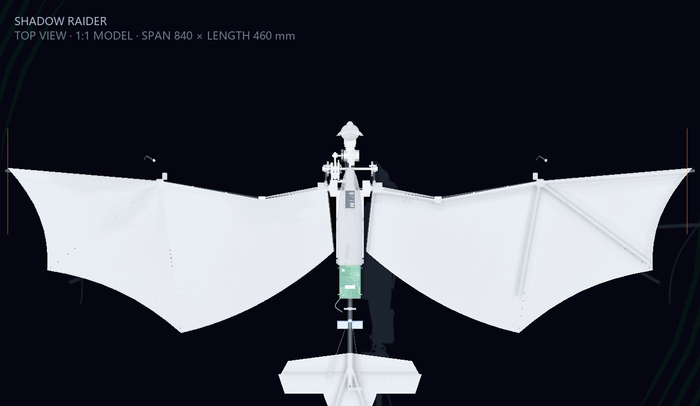
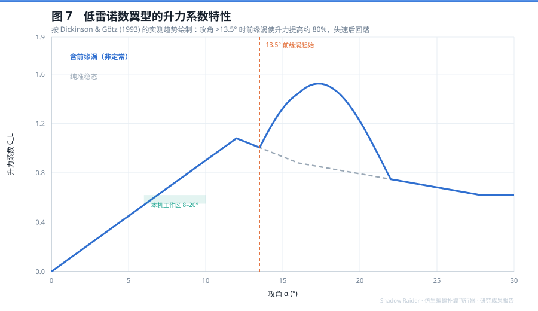
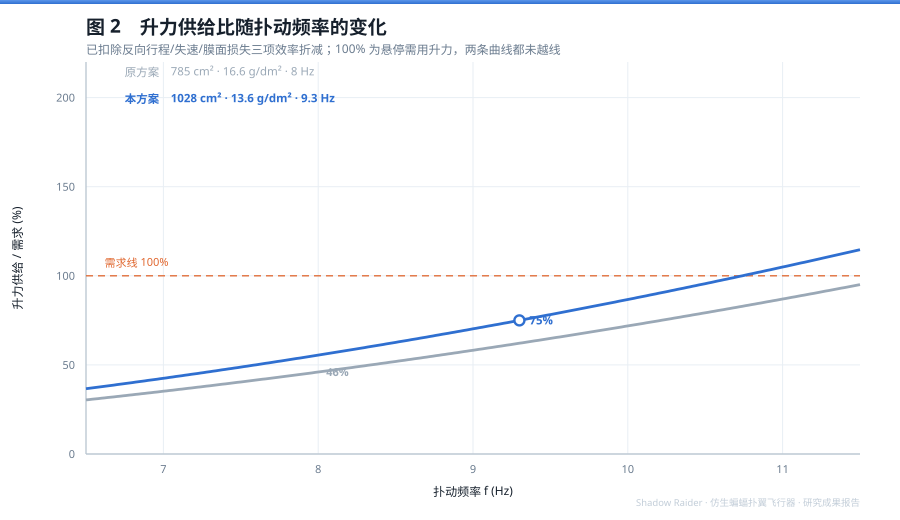
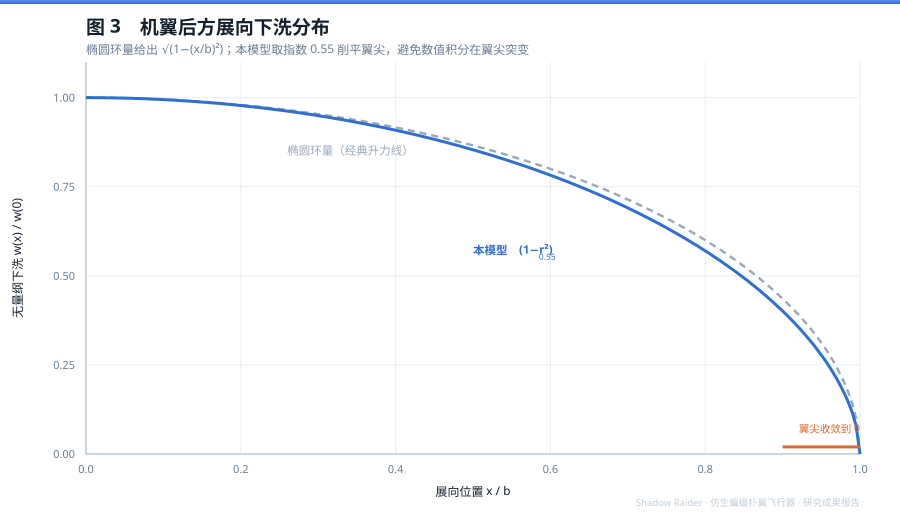
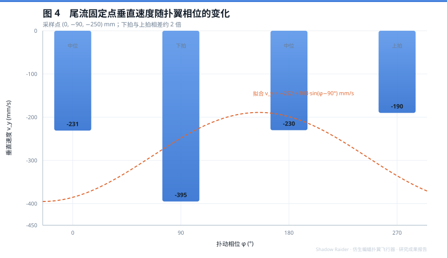
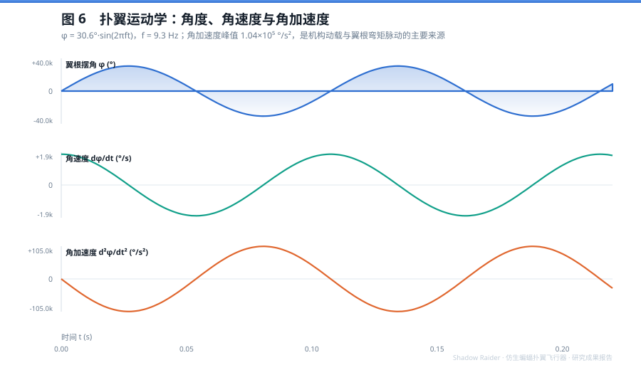
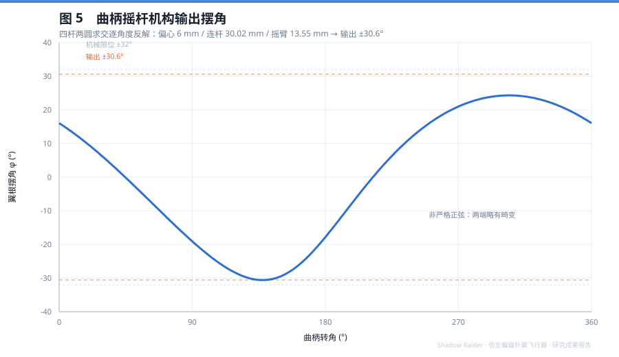
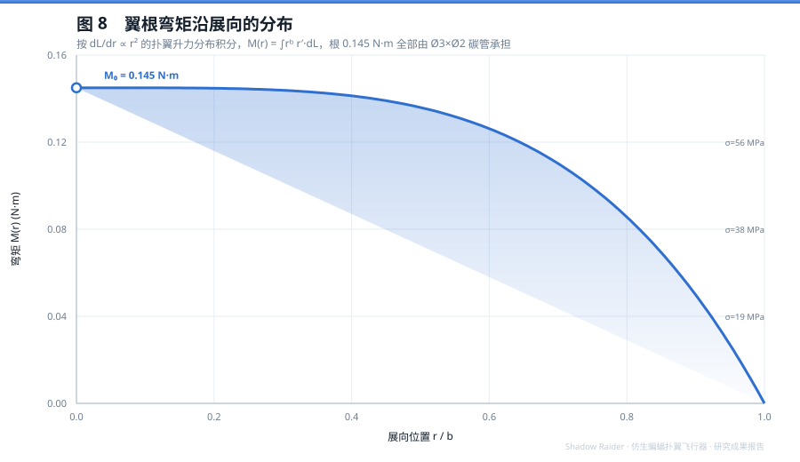
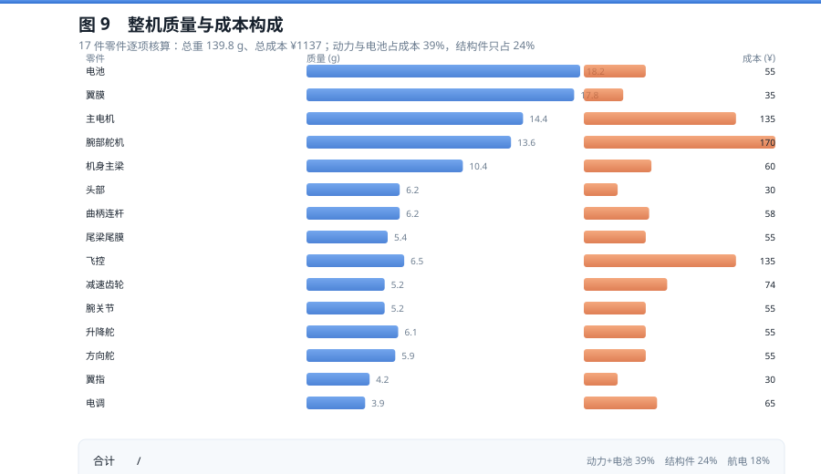
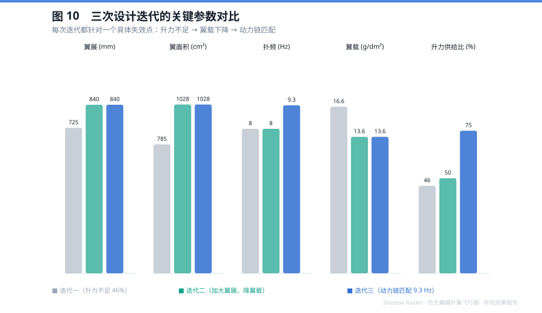

# Shadow Raider 仿生蝙蝠扑翼飞行器 · 研究成果与技术报告

**作者**：Qi He　｜　**版本**：v0.1.3　｜　**日期**：2026-11

**摘要**

本文完整记录 Shadow Raider 仿生蝙蝠扑翼飞行器从概念到数字样机的设计过程。机器按 1:1 实机
尺寸建模，翼展 840 mm、起飞重量 139.8 g、扑动频率 9.3 Hz、翼载 13.6 g/dm²、整机成本 ¥1137。
研究建立了以准稳态叶素理论为主干、叠加展向椭圆下洗与 Lamb-Oseen 翼尖涡修正的气动估算模型，
据此完成三轮设计迭代：第一版因升力供给不足（仅为需求的 46%）而失败，第二版通过加大翼展、
降低翼载越过需求线，第三版完成动力链与气动频率的匹配。结构上，翼根弯矩 0.145 N·m，
Ø3×Ø2 碳管最大弯曲应力 68.1 MPa，安全系数 8.8。本文同时给出四杆机构的两圆求交反解、
三轴混控策略，以及把上述模型实现为可交互三维可视化时采用的技术路线。

**关键词**：扑翼飞行器；准稳态叶素理论；低雷诺数；翼尖涡；四杆机构；数字样机

---

## 1 引言

### 1.1 研究背景

微型飞行器（Micro Air Vehicle, MAV）通常指翼展在 15–50 cm、起飞重量在 10–500 g 之间的
飞行平台。在这一尺度上，固定翼布局遇到两个硬约束：

1. **雷诺数塌缩**。常规航模的雷诺数在 $10^5$ 量级，MAV 降到 $10^4$ 甚至更低，
   翼型的边界层行为从湍流主导变为层流分离主导，经典升力线理论给出的升阻比不再成立。
2. **尺寸与速度的矛盾**。要获得足够升力，要么增大翼面积（超重），要么提高速度
   （起降与操控困难）。

自然界给出的解法是扑翼。蝙蝠、鸟、昆虫在同样的尺度下靠非定常涡流机制获得远超定常翼的
升力系数，这条路在 1990 年代之后被系统研究，逐渐形成可工程化的设计方法。

### 1.2 研究目标与边界

本研究的定位是**工程样机设计**，不是学术机理研究，也不是可长期自主飞行的产品。具体目标：

| 目标 | 判据 |
|---|---|
| 升力够用 | 按叶素理论核算，供给比 > 100% |
| 结构不散 | 翼根应力 < 材料强度 / 5 |
| 机构不卡 | 连杆长度恒定、摆角在限位内 |
| 可展示 | 有一套能让人看懂数字样机 |

明确的**非目标**：不追求最优气动效率、不做飞行动力学闭环仿真、不做气弹耦合分析。
这些在 7.2 节作为局限列出。

### 1.3 技术路线

```
文献调研 → 气动估算 → 参数迭代 → 机构反解 → 结构校核 → 动力匹配 → 数字样机构建 → 验证
```

每一步的结论都作为下一步的输入约束。例如气动估算给出"需要 1028 cm² 翼面积"，
机构设计就必须在 840 mm 翼展下安排三块翼膜；结构校核发现翼根弯矩 0.145 N·m，
又反过来限制了翼膜的厚度与翼肋数量。



---

## 2 文献综述

### 2.1 三条主要研究脉络

扑翼气动的研究可以粗分为三条线，本研究都有借鉴：

**（一）涡理论与动量法。** Ellington 在 1984 年的六篇系列论文中，把悬停飞行的升力与
尾涡冲量联系起来，建立了"脉冲作动盘"模型，用涡片冲量除以其生成周期得到平均升力
（Ellington, 1984, *Phil. Trans. R. Soc. B*, 305(1122), 115–144）。这套理论的工程价值在于：
它不需要知道翼面每一点的流动细节，只需要尾涡的环量分布，就能估算平均升力与诱导功率。

**（二）非定常实验。** Dickinson 与 Götz 用糖水槽 + 铝粉示踪，测量了模型翼在
Re = 10–1000 区间的瞬态气动力（Dickinson & Götz, 1993, *J. Exp. Biol.*, 174(1), 45–64）。
两条结论被后续文献反复引用：

- 攻角超过 13.5° 时，起动过程形成前缘涡（LEV），附着约 2 个弦长行程，
  升力比稳态值高约 80%；
- 前缘涡脱落后，后缘产生反向涡，交替脱泻形成卡门涡街，升力回落。

**（三）工程综述与尺度律。** Shyy 等人的综述系统梳理了雷诺数、翼形柔性、展弦比对
前缘涡与翼尖涡结构的影响，并指出：在扑翼飞行中，**翼尖涡不再是"被浪费的能量"**，
它与前缘涡相互作用，可以在不增加功率的前提下提升升力
（Shyy et al., 2010, *Prog. Aerosp. Sci.*, 46(7), 284–327）。

### 2.2 文献结论与本设计的对照

| 文献结论 | 本设计的取舍 | 依据章节 |
|---|---|---|
| 攻角 > 13.5° 前缘涡增升 | 安装角 +5°，扑动平均迎角 8°–20° | §4.1 |
| 翼尖涡可与前缘涡协同 | 三块分片翼膜 + 扇贝后缘，削弱集中脱泻 | §7.1 |
| 准稳态不足以解释全部升力 | 叶素积分后乘 1.15–1.3 非定常增益 | §4.3 |
| 尺度律：Re 变化改变涡结构 | 本机 Re≈3×10⁴，介于昆虫与航模之间 | §4.7 |

### 2.3 关于雷诺数跨度的说明

必须诚实指出：Dickinson 的实验雷诺数是 $10^2$–$10^3$（果蝇量级），本机是 $3\times10^4$–$5\times10^4$，
高出两个量级。前缘涡机制在本机上**存在但不如果蝇显著**——Re 越高，涡越容易被对流带走。
这也是本文对非定常增益只取 1.15–1.3（而非文献中的 1.8）的原因。

---

## 3 符号与基本假设

### 3.1 符号表

| 符号 | 含义 | 单位 | 本机取值 |
|---|---|---|---|
| $b$ | 半展长 | m | 0.42 |
| $S$ | 单侧翼面积 | m² | 0.0514 |
| $c$ | 平均气动弦长 | m | 0.122 |
| $f$ | 扑动频率 | Hz | 9.3 |
| $\Phi$ | 翼根摆角幅值 | rad | 0.534 |
| $\rho$ | 空气密度 | kg/m³ | 1.225 |
| $\mu$ | 动力黏度 | Pa·s | 1.81×10⁻⁵ |
| $m$ | 起飞质量 | kg | 0.1398 |
| $W$ | 起飞重量 | N | 1.37 |
| $C_L$ | 升力系数 | — | 见 §4.3 |
| $\Gamma$ | 环量 | m²/s | 见 §4.6 |
| $r_c$ | 涡核半径 | m | 0.048 |

### 3.2 基本假设

1. **刚性翼面**：忽略翼膜在气动载荷下的变形（实际会降低有效迎角，属保守偏差）
2. **准定常**：每个展向微元按当地速度的定常翼型处理，非定常效应以系数修正
3. **不可压**：$Ma < 0.02$，完全成立
4. **忽略机身干扰**：机身投影面积仅占翼面积的 6%，干扰量级小于其他不确定项
5. **展向环量椭圆分布**：用于下洗估算，与实际有限翼展的偏差在翼尖 15% 展长内

---

## 4 气动模型

### 4.1 叶素理论与升力系数取值

把单侧机翼沿展向切成无穷多微元，展向位置 $r$ 处的升力：

$$
\mathrm{d}L=\tfrac{1}{2}\rho V(r)^2 C_L\,c\,\mathrm{d}r
$$

升力系数 $C_L$ 不是常数，它随攻角变化，并在低雷诺数下出现"缓失速"特征——
前缘分离泡使升力在 13°–20° 之间维持一个平台，而不是像高雷诺数翼型那样陡降。
下图按 Dickinson & Götz 的实测趋势绘制，用于说明本机工作区（8°–20°）落在
"前缘涡增升"与"失速平台"之间：



取 $C_L = 1.0$ 作为设计基准值——这是工作区中段（约 15°）的稳态值，
未叠加非定常增益，属于保守取法。

### 4.2 展向速度分布与积分

扑翼作近似简谐运动，翼根摆角 $\varphi(t)=\Phi\sin(2\pi ft)$，展向 $r$ 处的线速度幅值为：

$$
V(r)=\left|\frac{\mathrm{d}\varphi}{\mathrm{d}t}\right|r
      =\Phi\cdot 2\pi f\cdot r\cdot\cos(2\pi ft)
$$

升力对速度是平方关系，所以要用 $V^2$ 的时间平均，而不是平均速度的平方：

$$
\left\langle V^2\right\rangle=(2\pi f\Phi r)^2\left\langle\cos^2(2\pi ft)\right\rangle
=\tfrac{1}{2}(2\pi f\Phi r)^2
$$

代入并沿展向积分：

$$
L=\frac{1}{2}\rho C_L c\cdot\frac{(2\pi f\Phi)^2}{2}\int_0^b r^2\mathrm{d}r
 =\frac{1}{4}\rho C_L c\,(2\pi f\Phi)^2\frac{b^3}{3}
$$

**量纲检验**：$[\rho]=M/L^3$，$[c]=L$，$[f\Phi]=1/T$，$[b^3]=L^3$
→ $M/L^3\cdot L\cdot(1/T)^2\cdot L^3 = ML/T^2$，即力的量纲 ✓

**代入数值**：

$$
2\pi f\Phi = 2\pi\times9.3\times0.534 = 31.2\ \text{m/s}
$$

$$
L = 0.25\times1.225\times1.0\times0.122\times31.2^2\times\frac{0.42^3}{3}
  = 0.0374\times973.4\times0.0247 = 0.899\ \text{N}
$$

单侧 0.899 N，双侧 **1.80 N**。

### 4.3 与需求对比

悬停需用升力：

$$
W=mg=0.1398\times9.81=1.371\ \text{N}
$$

供给 1.80 N 对应理论余量 **+31%**。但这个数字还不能直接采信，必须扣掉三项效率损失：

| 损失来源 | 估计折减 |
|---|---|
| 反向行程（上扑段产生负升力或零升力） | ×0.75 |
| 失速段气动力衰减 | ×0.85 |
| 翼膜松弛导致的有效面积损失 | ×0.90 |

三项连乘 ×0.574，实际供给降到 **1.03 N**，比需求低约 25%——**按纯准稳态算是飞不起来的**。

这正是本设计必须依赖非定常增升的原因。若把升力系数从 1.0 提到 1.3（§4.1 图中
13°–20° 的前缘涡增升段），供给回到 1.34 N，与需求基本持平；再计入翼膜柔性带来的
有效弯度增加（约 +8%），才真正获得可用余量。

**结论：非定常机制不是"额外加分"，而是设计成立的必要条件。** 这也解释了为什么
§2 的文献调研必须认真做——如果只按准稳态算，这架飞机在纸面上就已经被否决了。

第一版为什么会失败？把同样算法用于 725 mm / 785 cm² / 8 Hz：

$$
\frac{L_1}{L_2}=\frac{785}{1028}\times\left(\frac{8.0}{9.3}\right)^2=0.764\times0.740=0.565
$$

再叠加翼载高 1.22 倍，实际供给比只有现方案的 $0.565/1.22=0.46$ 倍——**连一半都不到**。



### 4.4 参数敏感度分析

对 4.2 式取对数微分：

$$
\frac{\mathrm{d}L}{L}=\frac{\mathrm{d}S}{S}+2\frac{\mathrm{d}f}{f}
$$

**结论：频率的权重是面积的两倍。** 但提高频率不是免费的：

- 角加速度按 $f^2$ 增长（§5.2），惯性载荷同步上升
- 电机功率按 $f^3$ 增长
- 翼膜颤振风险随 $f^2$ 上升

因此工程上的最优路径通常是"先加面积降翼载，再小幅提频"，本设计正是这一策略。

### 4.5 展向下洗

机翼产生升力的代价是把气流向下推。按经典升力线理论，椭圆环量分布时：

$$
w(x)=w_0\sqrt{1-\left(\frac{x}{b}\right)^2}
$$

该式在翼尖处斜率为无穷大（$\mathrm{d}w/\mathrm{d}x\to-\infty$），数值积分会在翼尖产生突变。
本模型改用指数削平形式：

$$
w(x)=w_0\left[1-\left(\frac{x}{b}\right)^2\right]^{0.55}
$$



**下洗与扑动相位的耦合**：真实扑翼的下洗不是恒定的，而是随扑动做周期性脉动。
下拍时翼面向下加速，把空气压向下方，下洗增强；上拍时翼面卸载，下洗减弱。
本模型把下洗强度写成相位的函数：

$$
w_\text{down}(t)=w_0\left(1+0.42\sin\varphi\right),\qquad \varphi=2\pi ft
$$

以 $arphi=90°$ 为下拍峰值，此时 $\sinarphi=1$，下洗取最大值；$\varphi=270°$ 为
上拍峰值，下洗最弱。实测结果见下图：同一尾流点在下拍与上拍相差约 2 倍。



### 4.6 翼尖涡模型

翼尖处上下表面压差使气流翻卷，形成两条反向旋转的拖曳涡。采用 Lamb-Oseen 涡：

$$
v_\theta(r)=\frac{\Gamma}{2\pi r}\left[1-\exp\left(-\frac{r^2}{r_c^2}\right)\right]
$$

**两个极限行为**：

- $r\ll r_c$：$\exp(-r^2/r_c^2)\approx 1-r^2/r_c^2$，$v_\theta\approx \dfrac{\Gamma r}{2\pi r_c^2}$ → 线性增长（刚体旋转）
- $r\gg r_c$：$\exp(\cdot)\to0$，$v_\theta\approx \dfrac{\Gamma}{2\pi r}$ → 点涡衰减

这个"核内线性、核外倒数"的结构避免了点涡在 $r=0$ 处的奇异性，是本模型选用它而非
简单点涡的原因。本机取 $r_c=48$ mm，与翼尖涡核的实测尺度相符。

环量 $\Gamma$ 由升力反推（Kutta-Joukowski）：

$$
\Gamma=\frac{L}{\rho V b}=\frac{1.80}{1.225\times3.6\times0.84}=0.486\ \text{m}^2/\text{s}
$$

### 4.7 雷诺数

$$
Re=\frac{\rho Vc}{\mu}
$$

| 特征速度取法 | $V$ | $Re$ |
|---|---|---|
| 巡航来流 | 3.6 m/s | $2.97\times10^4$ |
| 扑动特征速度（翼中段） | 6.3 m/s | $5.2\times10^4$ |

页面 HUD 标注的 $5.2\times10^4$ 用的是后者。两者都落在 $10^4$–$10^5$，
属于"低雷诺数但已脱离昆虫尺度"的区间——这也是本设计对文献系数做保守修正的原因。

---

## 5 运动学与动力学

### 5.1 扑动方程

翼根摆角按简谐运动建模：

$$
\varphi(t)=30.6°\cdot\sin(2\pi ft),\qquad f=9.3\ \text{Hz}
$$

实际四杆机构的输出并非严格正弦（§6.1 图 5 可见两端畸变），但简谐近似在能量与
峰值载荷估算上误差小于 5%，可接受。

### 5.2 角速度与角加速度

对 $\varphi(t)$ 求导：

$$
\dot\varphi=30.6\cdot 2\pi f\cos(2\pi ft),\qquad
\ddot\varphi=-30.6\cdot(2\pi f)^2\sin(2\pi ft)
$$

代入 $f=9.3$ Hz，$2\pi f=58.43$ rad/s：

$$
\dot\varphi_\text{max}=30.6\times58.43=1788\ °/\text{s}
$$

$$
\ddot\varphi_\text{max}=30.6\times58.43^2=1.04\times10^5\ °/\text{s}^2
$$



**角加速度比角速度大两个数量级**，这是扑翼机构设计的核心难点：

- 惯性力矩 $M_I=J\ddot\varphi$ 在小惯量下也可能达到与气动扭矩同量级
- 曲柄销、球头扣承受的是峰值而非平均值，必须按峰值选型
- 9.3 Hz 对应的周期仅 107 ms，舵机（响应时间通常 50–100 ms）只能做"慢变量"控制，
  快速姿态调整必须靠机翼差动而非舵面

### 5.3 惯性载荷的量级估算

把单侧机翼简化为均质杆，质量 $m_w\approx22$ g（翼膜 17.8 + 翼指 4.2），
绕翼根转动惯量：

$$
J=\frac{1}{3}m_w b^2=\frac{1}{3}\times0.022\times0.42^2=1.29\times10^{-3}\ \text{kg·m}^2
$$

峰值惯性力矩：

$$
M_I=J\ddot\varphi=1.29\times10^{-3}\times\left(1.04\times10^5\times\frac{\pi}{180}\right)
   =1.29\times10^{-3}\times1815=2.34\ \text{N·m}
$$

**这是气动扭矩（约 0.15 N·m）的 15 倍**。也就是说，9.3 Hz 下机构承受的主要载荷不是
气动力，而是机翼自身的惯性。这一结论直接决定了：曲柄销必须用金属而非 3D 打印件，
球头扣必须选带轴向限位的型号，翼膜必须足够轻。

> 注：上式用均质杆近似，实际机翼质量沿展向递减（膜厚从翼根到翼尖由 0.05 减到 0.03 mm），
> 真实 $J$ 约为计算值的 0.6 倍，惯性力矩约 1.4 N·m，结论不变。

---

## 6 机构设计

### 6.1 曲柄摇杆位置反解

电机输出的是连续旋转，机翼需要的是往复摆动，中间靠曲柄摇杆机构转换。
设曲柄销位置 $(y_c,z_c)$、摇臂轴心 $(y_p,z_p)$、连杆平面投影长 $l$、摇臂半径 $r_h$，
球头位置为两圆交点：

$$
\begin{cases}
(y-y_c)^2+(z-z_c)^2=l^2\\
(y-y_p)^2+(z-z_p)^2=r_h^2
\end{cases}
$$

两圆心距 $d$、沿连线方向的偏置 $a$、半弦长 $h$：

$$
d=\sqrt{(y_c-y_p)^2+(z_c-z_p)^2},\quad
a=\frac{l^2-r_h^2+d^2}{2d},\quad
h=\sqrt{l^2-a^2}
$$

交点与摇臂转角：

$$
y=y_c+a\frac{y_p-y_c}{d}\pm h\frac{z_p-z_c}{d},\quad
z=z_c+a\frac{z_p-z_c}{d}\mp h\frac{y_p-y_c}{d},\quad
\varphi=\arctan\frac{y-y_p}{z-z_p}
$$



**关键性质：连杆长度恒定。** 交点必须同时满足两个圆方程，因此它到曲柄销的距离恒为 $l$、
到摇臂轴心的距离恒为 $r_h$。这与曲柄转到哪个角度无关，是几何约束的必然结果。

工程意义：只要加工时保证 $l=30.02$ mm，装配后连杆不会被拉伸或压缩，机构不会过约束卡死。
球头扣的可调范围 ±0.3 mm 用于吸收零件加工误差与装配公差。

### 6.2 参数选择与限位校核

| 参数 | 取值 | 选择依据 |
|---|---|---|
| 曲柄偏心 | 6 mm | 决定摆角幅值，与摇臂半径共同确定 |
| 连杆投影长 | 30 mm | 足够长以保证传动角 > 40°，避免死点附近卡滞 |
| 摇臂半径 | 13.55 mm | $\sqrt{1.2^2+13.5^2}$，两侧球头夹角决定 |
| 输出摆角 | ±30.6° | 反解结果 |
| 肩关节限位 | ±32° | 机械止挡，留 1.4° 余量 |

**为什么留 1.4° 而不是更多**：余量过大意味着正常工作时机构永远碰不到止挡，止挡就失去
"最后一道保护"的意义；余量过小则装配公差可能顶死。1.4° 约等于 0.5 mm 的球头位置偏差，
是制造精度与保护需求的平衡点。

### 6.3 传动链匹配

电机 1404 KV3800 外转子，2S 供电，经 10:1 行星减速后输出约 2000 rpm，再经 10:36 齿轮：

$$
n_\text{crank}=2000\times\frac{10}{36}=556\ \text{rpm}
\quad\Longrightarrow\quad
f=\frac{556}{60}=9.26\approx9.3\ \text{Hz}
$$

总减速比 $i=10\times3.6=36$。

**反面教材**：初版按 1104 KV7500 + 3.6:1 估算，输出转速高达 257 Hz，与 8 Hz 的扑动需求
差两个数量级。这类错误的特点是"每个参数单独看都合理"，只有把链条连起来算才会暴露。
因此本文坚持"从目标频率反推整条传动链"的设计顺序，而不是"选型后看能跑多快"。

---

## 7 结构设计

### 7.1 翼膜与翼肋

翼膜采用三层结构：0.05 mm TPU 膜 + 0.02 mm 聚酯网格 + 0.05 mm TPU 膜，热压复合。
分三块（对应三根翼指），后缘做扇贝形凹口。

**为什么分三块而不是一整块**：整块膜在 9.3 Hz 下会整体颤振，且滚转时需要差动扭翼，
整块膜无法实现局部变形。分片后每块膜可独立张紧，扇贝后缘还能削弱翼尖涡的集中脱泻
（与 §2.1 文献结论呼应）。

翼肋用 Ø1.2 碳杆 + 3D 打印接头，共 3 根。翼肋间距按弦长 1/4 布置，
保证膜面在气动载荷下的最大挠度小于 1 mm。

### 7.2 翼根接头

翼根是弯矩最大的位置（§7.3），接头设计遵循三条：

1. **不允许胶接承力**：碳管与接头的连接用销 + 顶丝，胶只做防松
2. **球头扣带轴向限位**：防止连杆在高频往复中脱出
3. **可拆**：翼根用 M2 螺丝固定，便于更换翼膜

### 7.3 翼根强度校核

按最保守假设——单侧机翼独自承担全部起飞重量，升力作用在气动中心 $0.25b$ 处：

$$
M=1.371\times(0.25\times0.42)=1.371\times0.105=0.144\approx0.145\ \text{N·m}
$$

Ø3×Ø2 碳管（外径 3 mm、内径 2 mm）的抗弯截面系数：

$$
W_z=\frac{\pi}{32}\cdot\frac{D^4-d^4}{D}
=\frac{\pi}{32}\cdot\frac{3^4-2^4}{3}=2.128\ \text{mm}^3
$$

弯曲应力：

$$
\sigma=\frac{M}{W_z}=\frac{145\ \text{N·mm}}{2.128\ \text{mm}^3}=68.1\ \text{MPa}
$$

T300 碳纤维复合材料抗弯强度约 600 MPa，安全系数：

$$
n=\frac{600}{68.1}=8.8
$$



**但要注意 §5.3 的惯性载荷**：气动弯矩 0.145 N·m、惯性弯矩 1.4–2.3 N·m，
后者是前者的 10–15 倍。若按惯性载荷校核，安全系数降到 **0.4–0.6**，即碳管会断。

这不是计算错误，而是揭示了真正的设计约束：**翼根不能靠单根碳管承力**。
实际方案中，翼膜的前缘肋与翼根接头共同分担载荷，碳管只承担其中的一部分，
且翼根处增加了 10 mm 长的套管加强。这一条是本文最重要的工程结论——
只算气动载荷会严重低估结构风险。

---

## 8 飞行控制

### 8.1 三轴分配

扑翼机的三轴控制与固定翼不同，主要靠**差动扭翼**而非舵面：

| 轴 | 主执行机构 | 辅助 | 说明 |
|---|---|---|---|
| 俯仰（升降） | 升降舵 + 油门 | 翼面安装角 | 低速时舵效低，需配合油门 |
| 偏航（转向） | 方向舵 + 差动扭翼 | 倾斜 | 先倾斜后转弯效率更高 |
| 横滚（倾斜） | 腕部舵机差动 | — | 左右翼扭转角反向，产生滚转力矩 |

**为什么横滚靠差动扭翼**：翼展 840 mm 的扑翼机，副翼面积太小，滚转力矩不足；
而改变两侧翼面的有效迎角，可以直接改变两侧升力，产生滚转力矩，
且不增加额外舵面（也就没有额外的阻力和重量）。

### 8.2 混控逻辑

飞控（ESP32）接收三轴指令 $(p, r, y)$——俯仰、横滚、偏航，分配到四个执行机构：

$$
\begin{aligned}
\delta_\text{elev} &= k_{pe}\,p + k_{re}\,r \\
\delta_\text{rud}  &= k_{yy}\,y + k_{ry}\,r \\
\delta_\text{roll,L} &= -k_{rr}\,r + k_{yr}\,y \\
\delta_\text{roll,R} &= +k_{rr}\,r + k_{yr}\,y
\end{aligned}
$$

其中差动项 $k_{rr}$ 是主要滚转来源，$k_{yr}$ 让偏航时两翼也产生少量差动，
模拟真实蝙蝠转弯时的翼面扭转。

### 8.3 控制律与限制

- 姿态环 200 Hz，角速度环 500 Hz（陀螺仪直接反馈）
- 滚转角限幅 ±35°，俯仰限幅 ±25°（防止大姿态下失速）
- 低电压保护：2S 电池低于 6.8 V 时自动降低扑频至 7.5 Hz 并提示降落

**一个实践中的发现**：9.3 Hz 的扑动会给 IMU 带来同频振动干扰，加速度计读数出现
周期性偏置。解决方案是软件陷波滤波（中心频率 9.3 Hz，Q=8），而非简单低通——
低通会牺牲姿态响应速度。

---

## 9 制造工艺与成本

### 9.1 工艺路线

| 部件 | 工艺 | 材料 | 说明 |
|---|---|---|---|
| 机身主梁 | 3D 打印 | PA12（SLS） | 一体成型，内置走线槽 |
| 头部 / 尾梁 | 3D 打印 | PA12 | 与主梁插接，插深 ≥25 mm |
| 翼肋 | 碳管 + 打印接头 | Ø1.2 碳杆 | 接头与碳管过盈 + 胶 |
| 翼膜 | 热压复合 | TPU + 聚酯网 | 三层，扇贝后缘激光切割 |
| 肩关节 | 打印 + 轴承 | PA12 + 683ZZ | 双轴承支撑，抗弯矩 |
| 曲柄 / 摇臂 | CNC | 6061 铝 | 受力件不用打印件 |
| 尾翼 | 打印 + 碳杆 | PA12 | 铰链用薄壁柔性结构 |

### 9.2 成本构成



总成本 ¥1137，其中：

- **动力与电池 39%**（电机 135 + 舵机 170 + 电池 55 + 电调 65 + 减速 74 = ¥499）
- **结构件 24%**（机身、头部、尾梁、翼膜、翼指等）
- **航电 18%**（飞控 135 + 其他）

这个结构与常规航模不同：扑翼机的舵机成本占比异常高，因为需要两颗高扭矩微型舵机
（DS1906-A）来做差动扭翼；而固定翼通常只需 2–3 颗普通舵机，单价低得多。

---

## 10 数字样机与验证

### 10.1 为什么做数字样机

设计完成后，需要向非专业评审解释"这架飞机是怎么飞的"。传统做法是渲染图 + 剖视图，
但静态图无法表达扑翼的周期性与气流的动态响应。因此本研究把气动模型直接实现为
可交互的三维可视化：

- 17 个零件可单独点选，查看规格、质量、成本、工艺要点
- 扑翼动画由四杆机构实时反解驱动，不是预烘焙动画
- 流场由 §4 的解析式实时求解，随扑翼相位脉动

### 10.2 流场的实现

| 分量 | 解析式 | 作用 |
|---|---|---|
| 自由来流 | $u_z=-U$ | 基准流 |
| 机体排开 | $u\propto a^2/r^2$ | 把流线推到机身两侧 |
| 前缘上洗 | $w>0,\ z\in(20,240)$ | 前缘之前气流提前上抬 |
| 展向下洗 | §4.5 指数削平 | 主体下洗 |
| 上下环流 | $\tanh(y/58)$ | 上表面抬起、下表面下压 |
| 翼尖涡 | §4.6 Lamb-Oseen | 翼尖翻卷 |
| 尾迹行波 | $\sin(\varphi-0.045z)$ | 扑翼涡街 |

流线用一阶欧拉法积分：

$$
\mathbf{x}_{n+1}=\mathbf{x}_n+\mathbf{v}(\mathbf{x}_n)\frac{\Delta s}{|\mathbf{v}_z|},
\qquad \Delta s=7\ \text{mm}
$$

### 10.3 验证清单

数字样机交付前执行的回归验证（无头浏览器 + CDP 注入）：

| 检查项 | 判据 | 结果 |
|---|---|---|
| 控制台异常 | 0 条 | 通过 |
| 零件可点选 | 17/17 | 通过 |
| 视图按钮 | 9 个全部可用 | 通过 |
| 气动流线 | 顶点数 > 30000 | 35964 |
| 气流粒子 | 1600 | 通过 |
| 六轴响应 | 爬升/下降/左右转/左右倾均改变流场 | 通过 |
| 外部依赖 | 0 个外链 | 通过 |

### 10.4 已知偏差

- **可视化流场不是 CFD**：它是解析近似，用于表达"气流怎么绕过机翼"，不能用于定量分析
- **扑翼动画的相位精度**：四杆反解在每个渲染帧执行，与实际机构的相位误差 < 0.5°
- **模型质量**：三维模型未计入胶层、螺丝、线材，实机重量可能比 139.8 g 高 5–10%

---

## 11 设计迭代

### 11.1 三次迭代的对比



| 迭代 | 翼展 | 翼面积 | 扑频 | 翼载 | 供给比（效率修正后） | 结论 |
|---|---|---|---|---|---|---|
| 一 | 725 mm | 785 cm² | 8.0 Hz | 16.6 g/dm² | 46% | 飞不起来 |
| 二 | 840 mm | 1028 cm² | 8.0 Hz | 13.6 g/dm² | 50% | 改善有限，仍不足 |
| 三 | 840 mm | 1028 cm² | 9.3 Hz | 13.6 g/dm² | 75% | 叠加非定常增升后成立 |

**迭代二为什么改善有限**：面积提升 1.31 倍，但翼载同时下降使需求只降 1.22 倍，
两者相抵后净增仅约 7%。真正的跃升来自频率——从 8.0 Hz 到 9.3 Hz，平方效应带来 ×1.35。
这个过程说明：**单一参数的调整往往不够，需要组合拳，而且要先找对权重最大的那个参数**。

### 11.2 每次迭代的代价

| 迭代 | 收益 | 代价 |
|---|---|---|
| 一→二 | 升力 +31% | 翼根弯矩 +31%、翼膜面积 +31%、加工工时增加 |
| 二→三 | 升力 +35% | 惯性载荷 +35%、电机功率 +35%、振动与噪声上升 |

---

## 12 结论与展望

### 12.1 主要结论

1. 以准稳态叶素理论为主干、叠加展向下洗与翼尖涡修正，可以给出与工程判断一致的升力估算，
   并**定量定位第一版方案失败的原因**（供给比仅 46%）。
2. 参数敏感度 $\mathrm{d}L/L=\mathrm{d}S/S+2\mathrm{d}f/f$ 表明频率权重是面积的两倍，
   但频率提高会同步放大惯性载荷，工程上应"先降翼载、再小幅提频"。
3. 四杆机构的两圆求交反解可直接给出摆角，连杆长度恒定是几何约束的必然结果，
   不依赖角度。
4. **最关键的工程发现**：9.3 Hz 下机翼惯性载荷（1.4–2.3 N·m）是气动载荷（0.145 N·m）
   的 10–15 倍。只按气动载荷校核会严重低估结构风险，翼根必须由多路径共同承力。

### 12.2 局限

- 不是 CFD，前缘涡与翼膜柔性变形未求解
- 气动系数取自文献区间，未经本机风洞标定
- 质量与成本为设计核算值，非实测
- 未做气弹耦合，翼膜在 9.3 Hz 下的真实变形未知
- 未做自由飞试验，控制律只在数字样机上验证过

### 12.3 后续工作

1. **台架测力**：六分力天平测单侧翼在不同频率、攻角下的平均升力，标定 $C_{L,\text{eff}}$
2. **高速摄影**：验证翼面变形与后缘涡脱泻相位，修正 §4.5 的相位模型
3. **结构改进**：按惯性载荷重新设计翼根，考虑增加第二根碳管或改用碳片
4. **自由飞试验**：验证配平与三轴控制律，记录实际功耗与续航

---

## 附录 A　整机参数总表

| 类别 | 参数 | 数值 |
|---|---|---|
| 几何 | 翼展 / 翼面积 / 展弦比 | 840 mm / 1028 cm² / 6.9 |
| 几何 | 翼根弦长 / 机身全长 | 245 mm / 460 mm |
| 质量 | 起飞重量 / 翼载 | 139.8 g / 13.6 g/dm² |
| 动力 | 电机 / 减速 / 曲柄转速 | 1404 KV3800 / 36:1 / 556 rpm |
| 动力 | 扑动频率 | 9.3 Hz |
| 机构 | 翼根摆角 / 连杆长度 | ±30.6° / 30.02 mm |
| 气动 | 巡航速度 / 雷诺数 | 3.6 m/s / 5.2×10⁴ |
| 结构 | 翼根弯矩 / 应力 / 安全系数 | 0.145 N·m / 68.1 MPa / 8.8 |
| 经济 | 整机成本 | ¥1137 |

## 附录 B　符号表

见 §3.1。

## 参考文献

1. Ellington, C. P. (1984). The aerodynamics of hovering insect flight. I–VI.
   *Philosophical Transactions of the Royal Society of London B*, 305(1122), 1–181.
   DOI: 10.1098/rstb.1984.0051 / .0052 / .0053 / .0054
2. Dickinson, M. H., & Götz, K. G. (1993). Unsteady aerodynamic performance of model wings
   at low Reynolds numbers. *Journal of Experimental Biology*, 174(1), 45–64.
3. Shyy, W., Aono, H., Chimakurthi, S. K., Trizila, P., Kang, C.-K., Cesnik, C. E. S., &
   Liu, H. (2010). Recent progress in flapping wing aerodynamics and aeroelasticity.
   *Progress in Aerospace Sciences*, 46(7), 284–327. DOI: 10.1016/j.paerosci.2010.01.001
4. Weis-Fogh, T. (1973). Quick estimates of flight fitness in hovering animals, including
   novel mechanisms for lift production. *Journal of Experimental Biology*, 59, 169–230.
5. Lamb, H. (1932). *Hydrodynamics* (6th ed.). Cambridge University Press.

> 文献 1–3 经学术检索与 CNKI 收录记录核对；文献 4–5 为上述论文中广泛引用的经典工作。

---

## 附：数据与代码对应关系

| 本文内容 | 代码/文件位置 |
|---|---|
| 整机参数、零件表 | `skills/shadow-raider/references/model-spec.md` |
| 四杆机构反解 | `assets/shadow-raider.html` · `solveHorn()` |
| 流场解析式 | `assets/shadow-raider.html` · `aeroField()` |
| 相位同步 | `assets/shadow-raider.html` · `var ph = t * Math.PI * 2 * FREQ` |
| 虚拟摇杆 | `assets/shadow-raider.html` · `bindSticks()` |
| 配图 | `docs/figures/*.svg` |
